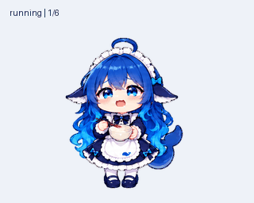
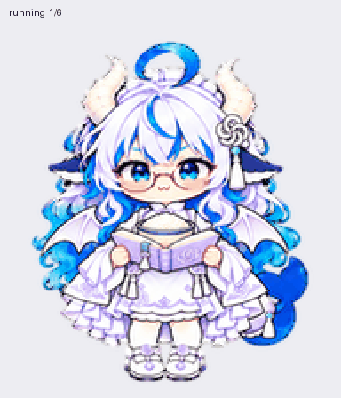

# Codex Pet Gallery

[简体中文](README.md) · **English**

Give Codex and ChatGPT Work a desktop companion who sneaks bites and wags her tail.

[Version gallery](VERSIONS.en.md) · [Installation](docs/INSTALL.en.md) · [Release notes](RELEASE_NOTES.en.md)

## Characters

### DeepSeek-chan · Foodie Edition `1.0.1`

She waits with an empty bowl, tucks into rice while you work, and kicks her feet and wags her tail when you pick her up with the mouse.

**[Desktop installer ZIP](https://github.com/HanaRo/codex-pet-gallery/releases/download/v1.0.1/deepseek-chan-1.0.1-pet.zip)** · [Work import PNG](https://github.com/HanaRo/codex-pet-gallery/releases/download/v1.0.1/deepseek-chan-1.0.1-spritesheet.png) · [Character details](pets/deepseek-chan/README.en.md)

For the empty-handed blinking idle and little side-to-side run, see [Classic 1.0.0](VERSIONS.en.md#classic-100).

### DeepSeek-chan · Scholar Disguise `1.0.0`

This white-dragon scholar hides her rice behind a book. She raises it to sneak bites and straightens her wig when you pick her up.

**[Desktop installer ZIP](https://github.com/HanaRo/codex-pet-gallery/releases/download/v1.1.0/deepseek-gpt-scholar-1.0.0-pet.zip)** · [Work import PNG](https://github.com/HanaRo/codex-pet-gallery/releases/download/v1.1.0/deepseek-gpt-scholar-1.0.0-spritesheet.png) · [Character details](pets/deepseek-gpt-scholar/README.en.md)

## Installation and development

- **Install.** Desktop Codex uses a pet config and sprite sheet. ChatGPT Work can import a PNG through a v2-compatible entry point. [Installation and import](docs/INSTALL.en.md)
- **Rebuild or contribute.** Rebuild an atlas from the final frames, or inspect the nine animation states and 16 gaze directions. [Reproduction guide](docs/REPRODUCING.en.md) · [Playback](docs/PLAYBACK.en.md) · [Contributing](CONTRIBUTING.en.md)
- **Credits and rights.** The characters and animations are community-made. [Credits](CREDITS.en.md) · [Asset rights](ASSET_LICENSE.en.md) · [Tool code license](LICENSE)
