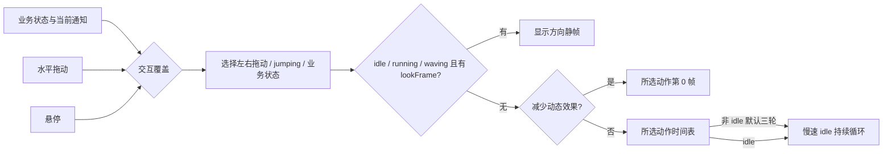

# 状态切换：设计与验收约定

记录日期：2026-10-22。内部播放行为核查于桌面客户端 **26.1016.61520 / build 21421**；本次重新读取已安装的程序包，确认与先前核查的三个相关模块一致。这里保存行为结论和独立编写的检查工具，不分发客户端代码，也不修改客户端。

[官方 Pets 文档](https://learn.chatgpt.com/docs/pets)说明活动状态含义、不同入口以及减少动态效果；以下精确的帧时长、优先级和中断行为来自本机版本核查。将来客户端升级后应重新检查，不能把这个快照当成稳定 API。角色画面名称以 1.0.1 为准；1.0.0 冻结素材保留其旧画面。

## 三层状态需要分开

1. **业务状态**：idle、running、waiting、failed、review，首次唤醒欢迎还可能是 waving。通知优先级或展示的线程改变时，可能直接从一种业务状态切到另一种，不保证完整经历“工作→完成→待机”。
2. **交互覆盖**：左右拖动优先，其次是鼠标悬停 jumping，再回到业务状态。角色的 jumping 当前被设计为站立摇尾巴，左右拖动当前被设计为揪起悬空。
3. **实际画面**：在选中的状态为 idle / running / waving 时，非空 lookFrame 会直接显示十六方向静帧。没有 lookFrame 时才执行动作时间表；动作播完还可能进入慢速 idle，但逻辑状态仍然是原状态。

因此，“还在 running”与“画面正在扒饭”并非同一件事。看见 idle 也不能据此推断任务已完成。



## 实际存在的切换

| 类型 | 典型切换 | 播放行为与检查重点 |
| --- | --- | --- |
| 任务开始、继续、重试 | idle / waiting / failed / review → running | 直接进入 running 第 0 帧；优先对齐身体、脸、碗和手，不要假设上一动作先收尾。 |
| 任务结果或输入需求 | running → waiting / review / failed；waiting → running / failed / idle；review / failed → idle | 新通知或当前展示线程也能触发切换。检查任意源帧到目标第 0 帧，包含快速连续变化。 |
| 欢迎结束 | waving → idle 或当前业务动作 | 欢迎可以被活动、悬停、拖动和注视打断。 |
| 播放器自动回落 | 所有非 idle 动作 → 慢速 idle | 默认动作三轮后直接进入 idle 第 0 帧；逻辑状态不变，也没有退出动画或淡化。 |
| 鼠标进入、离开 | 业务动作 ↔ jumping | 悬停进入摇尾巴，离开后重新执行当前业务动作的时间表，而不是接着旧帧播放。 |
| 拖动开始、反向 | 业务 / jumping → running-left / running-right；左右互切 | 水平方向变化会从目标行第 0 帧重新开始。固定抓取点比固定脚底更适合悬空动作。 |
| 拖动松手、取消 | running-left / running-right → jumping 或当前业务动作 | 松手清除临时拖动状态；鼠标仍悬停时回到 jumping，否则回到业务状态。没有专门的“放下”行。 |
| 注视覆盖、方向变化、解除 | idle / running / waving ↔ look；look → look | 有方向时静态覆盖，解除后动作从第 0 帧重启。角度有 16 档，检查邻近角度和四个主方向。 |
| 系统减少动态效果 | 任意动作 → 相应第 0 帧；恢复时重启时间表 | 第 0 帧必须独立可读。可用的 lookFrame 仍是方向静帧。 |
| 相同状态内容刷新 | running → running 等 | 只更新命令文字、同状态活动或拖动方向不变，通常不重新启动动作；不能依赖不断更新文本让动作一直播放。 |

这不是严格的线性流程。不同线程通知竞争、悬停和拖动交错、注视覆盖，都能产生跨组切换。`tools/preview_transitions.py` 的 9×9 末帧→首帧矩阵是素材压力检查，**不是所有 81 个组合都由同一入口直接触发的可达性证明**。

## 准确时间表与硬切边界

| 动作 | 每帧时长（ms） | 默认自动回落前 |
| --- | --- | --- |
| running | 120,120,120,120,120,220 | 820×3 = 2460 ms |
| waiting | 150,150,150,150,150,260 | 1010×3 = 3030 ms |
| review | 150,150,150,150,150,280 | 1030×3 = 3090 ms |
| failed | 前 7 帧各 140，末帧 240 | 1220×3 = 3660 ms |
| waving | 140,140,140,280 | 700×3 = 2100 ms |
| jumping | 140,140,140,140,280 | 840×3 = 2520 ms |
| running-left / running-right | 前 7 帧各 120，末帧 220 | 1060×3 = 3180 ms |
| 慢速 idle | **1680,660,660,840,840,1920** | 6600 ms，持续循环 |

慢速 idle 是基础时长 `[280,110,110,140,140,320]` 各自乘 6，**不是每帧均匀 1100 ms**。旧的均匀速度预览只能帮助观察姿势，不代表精确播放节奏。

`running → idle` 的自然边界是第三轮 running 第 5 帧结束后直接进入 idle 第 0 帧。若业务状态改变，则可能从 running 任意一帧硬切到目标第 0 帧。播放器直接设置背景图格子，没有素材可配置的混合比例、独立退出状态、插帧或过渡矩阵。不能在预览里加入客户端不存在的补间，再据此宣称已经改善真实切换。

当前入口未启用内部可用的非 idle 无限循环选项。即使某个方向保持不变，拖动行也可能在三轮后进入慢速 idle；素材无法让这个计时器改为无限循环。纯竖直拖动也没有专用行：本机代码按约 4 个屏幕坐标单位的水平增量决定左右动作。

## 当前角色的重点风险

| 优先级 | 边界 | 风险与后续动作 |
| --- | --- | --- |
| 已改善，继续回归 | running 的每一帧 → idle 第 0 帧 | 1.0.1 已收小举筷动作，修正头发/鳍耳偏宽，统一身体尺度、脚底和碗位置。筷子、米饭与双手递碗仍有语义差别，不能声称像素级无缝。 |
| 已改善，继续回归 | idle / running ↔ jumping | 1.0.1 的摇尾巴沿用捧碗与新脸型，消除旧空手帧导致的碗突然消失。任意帧退出时仍需检查尾巴位置差异。 |
| P1 | idle / running / waving ↔ look | 当前十六方向来自原版无碗姿势，新 idle 抱碗，静帧覆盖会使碗消失。以后更新 look 时应沿用新中性姿势和道具；本次不顺带重画已确认的方向行。 |
| P1 | running-left ↔ running-right | 镜像动作的呆毛抓取点在格子中的位置也会镜像；切向时可能横向跳动。后续应统一左右抓取点，同时保持完整轮廓和原始时序。 |
| P1 | 悬空拖动 → jumping / idle | 1.0.1 的悬空拖动、摇尾巴和 idle 均持碗，但悬空与落地姿态仍有差异。当前客户端没有放下动画；设计目标是固定身体尺度、控制位移，并让目标第 0 帧足够接近，而不是制作无法被调用的额外行。 |
| P2 | waiting / review / waving / failed ↔ 抱碗组 | 目前部分动作空手，部分拿碗。后续改版需要预先决定哪些道具持续存在、放在哪里，不能每一行独立设计。 |
| P2 | 首帧与循环首尾 | 第 0 帧同时是状态入口、减少动态效果画面；最后一帧既接下一轮第 0 帧，也可能接 idle。两种边界都要看。 |

这些风险记录不表示要一次重画全部动作。每次修改限定受影响的行，保留其他行的像素和可回退版本；对仍保留的风险作明确记录。

## 后续开发必须检查的项目

1. 先确定中性身体、头部比例、站立脚底、悬空抓取点，以及碗/工具的共享坐标。首帧以中性、可独立显示为优先。
2. 每一行动作内部检查首尾循环，同时检查它自然结束到 idle、任意帧被打断到其他业务状态。只检查末帧不够。
3. 至少覆盖：工作三轮回落；工作在全部 6 帧分别中断；idle→工作；工作↔等待；工作→完成/失败；重试；悬停进入/离开；拖动反向/松手；注视覆盖/解除；减少动态效果。
4. 悬空动作共享抓取点，落地动作共享脚底。不要为了让脚底对齐而消除悬空晃动；不要把每个姿势各自缩放到最大。
5. 用实际编码 atlas 导出 GIF，记录精确帧时长。对比图必须让前后两版使用同一组状态事件和时钟。几何指标用于发现问题，不代替动作语义和视觉判断。
6. 调整动作图可以改善姿态、尺度、表情和道具跳变；状态优先级、任意时刻切换、无限循环、过渡混合属于播放器能力，本仓库不能借上传图片改变它们。

## 导出切换预览

```bash
python tools/preview_transitions.py \
  --atlas pets/deepseek-chan/versions/1.0.1/spritesheet.png \
  --output dist/transitions

# 比较两个 atlas：所有画面使用相同的切换时间表
python tools/preview_transitions.py \
  --atlas /path/to/after.png --compare /path/to/before.png \
  --output dist/transition-comparison
```

输出包含工作三轮回落、全部工作帧中断、常见业务与交互边界 GIF、四组关键静帧、81 个首尾压力边界及几何指标。它是离线 QA 模型，不会安装角色，也不修改客户端。发布仍需实际素材验证、视觉检查与独立版本目录。
