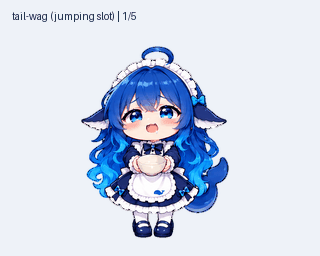

# DeepSeek-chan · Foodie Edition 1.0.1

[简体中文](../../pets/deepseek-chan/versions/1.0.1/README.md) · **English**

Snapshot applied on 2026-10-22. The archived sprite sheet matches the pixels downloaded from the installed pet.

This release updates 33 frames across idle, both drag directions, jumping (standing tail wag), and running (rice eating). The other 40 retain their original pixels, including all 16 gaze directions.

- **Idle.** Waits with an empty bowl, breathes gently, and blinks fully.
- **Horizontal drag.** The mouse picks her up by her cowlick. She kicks her feet, wags her tail, and sways. The left row mirrors the right frame by frame in the same order.
- **Tail wag.** She holds the bowl as the tail moves behind her and alternates between sides.
- **Rice eating.** A shorter chopstick lift and narrower hair and ear fins bring the silhouette closer to idle. The character measures 147–149 px wide and 191–192 px tall, compared with 150 × 191 px at idle, using an alpha threshold of 16.

[All animations](../../pets/deepseek-chan/versions/1.0.1/previews/all-states.gif) · [Animation video](../../pets/deepseek-chan/versions/1.0.1/previews/all-states.mp4) · [Eating silhouette comparison](../../pets/deepseek-chan/versions/1.0.1/previews/eating-width-comparison.gif) · [Transition QA](../../pets/deepseek-chan/versions/1.0.1/previews/transitions/)

The approved 73 lossless PNGs in `frames.zip` are the inputs for exact reconstruction. The source folder includes selected artwork, high-resolution strips, prompts, drag key poses, the frame-by-frame mirror source, and a recent pre-edit atlas. The left drag strip is derived at native size. The right drag strip is the high-resolution source. The QA folder contains sanitized validation records, registration settings, version differences, and post-installation pixel comparisons. [Final frames](../../pets/deepseek-chan/versions/1.0.1/frames.zip) · [Sources](../../pets/deepseek-chan/versions/1.0.1/sources/) · [QA records](../../pets/deepseek-chan/versions/1.0.1/qa/)

The previews use the inspected client's frame timings. Individual state GIFs repeat one cycle. The three-loop fallback is shown in a separate preview. The gaze loop demonstrates direction order. Older uniform-timing previews remain in the historical release. [Running to idle](../../pets/deepseek-chan/versions/1.0.1/previews/transitions/running-auto-idle.gif)

Some gaze poses and task states reuse empty-handed frames, so the bowl can disappear. The mirrored grab point can shift on drag reversal. The client directly switches between cells on release, and its three-loop limit comes from the player. [State transitions](../TRANSITIONS.en.md)

[Classic 1.0.0 release](https://github.com/HanaRo/codex-pet-gallery/releases/tag/v1.0.0) · [Asset rights](../../ASSET_LICENSE.en.md) · [Credits](../../CREDITS.en.md)
