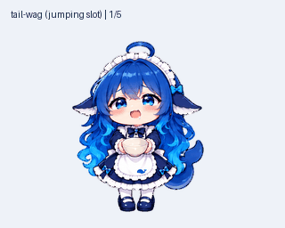

# DeepSeek-chan

[简体中文](README.md) · **English**

A blue-haired chibi maid who likes thinking and eating. Both editions eat while you work and wag their tails when standing. Each has its own idle and drag animations. [Home](../../README.en.md) · [Version gallery](../../VERSIONS.en.md) · [Installation](../../docs/INSTALL.en.md)

| Version | Idle and drag | Downloads and details |
| --- | --- | --- |
| Classic 1.0.0 | Blinks and breathes empty-handed, then runs when dragged | [Installer](https://github.com/HanaRo/codex-pet-gallery/releases/download/v1.0.0/deepseek-chan-1.0.0-pet.zip) · [Sprite sheet](versions/1.0.0/spritesheet.png) · [Release notes](../../docs/releases/v1.0.0.en.md) |
| Foodie Edition 1.0.1 | Waits with an empty bowl, then kicks her feet and wags her tail when picked up | [Installer](https://github.com/HanaRo/codex-pet-gallery/releases/download/v1.0.1/deepseek-chan-1.0.1-pet.zip) · [Sprite sheet](versions/1.0.1/spritesheet.png) · [Version details](../../docs/versions/deepseek-chan-1.0.1.en.md) |

[Compare the idle previews and see all animations.](../../VERSIONS.en.md#deepseek-chan)

## Foodie Edition previews

[All animations GIF](versions/1.0.1/previews/all-states.gif) · [16 gaze directions](versions/1.0.1/previews/look-loop.gif) · [State transitions](versions/1.0.1/previews/transitions/)

## Assets and reproduction

Both versions have their own desktop config, frames, and QA records. [Classic files](versions/1.0.0/) · [Foodie Edition files](versions/1.0.1/) · [Offline reproduction](../../docs/REPRODUCING.en.md)
